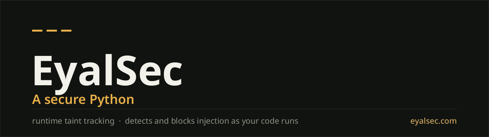

# es-python

**The EyalSec Python runtime, and the best Python security product there is. Run your existing Python app through it, unchanged, and it reports or blocks attacker-controlled data reaching a SQL query, a shell command, a deserializer, a file path or a dynamic import.**

[](https://eyalsec.com)
[](https://eyalsec.com/docs)
[](https://scorecard.dev/viewer/?uri=github.com/EyalSec/es-python)

**For:** AppSec and security engineers, and the backend teams they work with,
running Python services (Django, Flask, FastAPI, Celery workers, internal
tools) that hold data worth stealing. Linux, x86_64 and aarch64, Python 3.9,
3.10, 3.11, 3.12, 3.13 and 3.14.

## Install and run

Once your plan is set up ([book a live demo](https://eyalsec.com/contact)), add
a machine on the **Machines** page of your dashboard and paste its one-line
install command into a terminal on that machine. The real command comes from
the panel; it carries a one-time token that is valid for 10 minutes:

```bash
curl -sSL -d "secret=abcd*****wxyz" https://eyalsec.com/install.sh | bash
```

`es-python` installs into your home directory and leaves your normal Python as
it was. Then, wherever you would type `python`, type `es-python`:

```bash
exec $SHELL          # pick up the new PATH
eyalsec selftest     # sends one harmless test event to your dashboard
es-python app.py     # also: es-python -m flask run, es-python -m pytest
```

A new machine watches network input (**socket**) and file reads (**file**) from
the start; every other source is off until you switch it on in **Configure**.
Full walkthrough: **[Quick start](https://eyalsec.com/docs/quick-start)**.

## One event

A Flask search endpoint that builds its SQL from the query string:

```python
@app.get("/products")
def search_products():
    term = request.args.get("q", "")
    conn = sqlite3.connect("shop.db")
    rows = conn.execute(
        f"SELECT id, name, price FROM products WHERE name LIKE '%{term}%'"
    ).fetchall()
    conn.close()
    return jsonify(rows)
```

A request whose `q` is `%' OR 1=1 --` turns the search into "every product"
and produces one event. On the dashboard it reads (abridged):

> **Severity:** Critical · **Event:** `sqlite execute` · **Impact tag:** `sqli`
>
> **What happened:** `sqlite3.Cursor.execute()`: Data that came in over the
> network was used to build a database query.
>
> **Why this is risky:** An attacker who can send data to this program over the
> network may use this SQL injection to read or change any data in the
> database, and get past checks such as who may see which row.
>
> **What to do:** Use placeholders (`?` or `%s`) and pass the value as a
> parameter rather than joining strings or f-strings, so the database always
> treats it as data.

Below that come the evidence blocks: the value as it reached the database, the
value as it first arrived from the network, the call path down to
`search_products`, the connection it came in on, and the command line that
started the program. Five runnable walkthroughs (Flask, Django, FastAPI,
`subprocess`, `pickle`) are in [`examples/`](examples/).

## How it works

- **Source**: where untrusted data enters. A network socket, a file, standard
  input, environment variables and command-line arguments, or code another
  user on the machine can write. Each is a switch on your dashboard.
- **Sink**: a risky operation it flows into. A database query, a shell
  command, a deserializer, a file path, a dynamic import, an outbound
  connection, a template.
- **Event**: recorded when data from a source reaches a sink. Detection runs
  inside your program as it executes, not beside it, and is checked at the
  operation itself, so it fires on what the program really did with the data,
  whichever library built the string.
- **Report, or Report and Raise**: Report logs the event and lets the program
  continue. A **Raise (machine)** rule also stops the operation: the program
  gets a `RuntimeError` at that line, and the event is still recorded.

## What it catches

- [SQL injection](https://eyalsec.com/vulnerabilities/sql-injection), on the
  statement text of the drivers your app really uses: `sqlite3`, `psycopg2`,
  `psycopg` 3, `mysqlclient`, `mariadb`, `oracledb`, plus Django's `raw()` and
  `extra()`, SQLAlchemy's `text()`, asyncpg, aiomysql, mysql-connector,
  Cassandra and ClickHouse
- [Command injection](https://eyalsec.com/vulnerabilities/command-injection):
  shell metacharacters, argument injection, environment and `PATH` tampering,
  Paramiko `exec_command`
- [Path traversal](https://eyalsec.com/vulnerabilities/path-traversal),
  null-byte injection, zip and tar extraction escapes
- [Insecure deserialization](https://eyalsec.com/vulnerabilities/insecure-deserialization):
  `pickle`, `marshal`, PyYAML's unsafe loaders, jsonpickle
- [Code injection](https://eyalsec.com/vulnerabilities/code-injection):
  `exec`, `eval`, `compile`, dynamic import
- [SSRF](https://eyalsec.com/vulnerabilities/ssrf), checked on the address the
  program actually dials, so a redirect or an internal hostname still counts
- [Server-side template injection](https://eyalsec.com/vulnerabilities/server-side-template-injection)
  (Jinja2, Django, Mako, Tornado), XXE, XPath and LDAP filter injection
- [NoSQL injection](https://eyalsec.com/vulnerabilities/nosql-injection)
  (PyMongo, Redis `eval`, Neo4j Cypher), CRLF header injection, log forging
- Unverified JWTs, weak hashes and KDFs, timing-unsafe comparison,
  [predictable tokens](https://eyalsec.com/vulnerabilities/weak-randomness),
  [hardcoded credentials](https://eyalsec.com/vulnerabilities/hardcoded-credentials)
  reported where they leave the process, and
  [code loaded from a file another user can write](https://eyalsec.com/vulnerabilities/untrusted-code-loading)

Nineteen third-party libraries have checks of their own, and when a new
release of one renames a method `es-python` watches, the gap is reported to
EyalSec rather than silently dropped. A correctly parameterized query never
fires: the check is on the statement, never on a bound parameter.

## Two severe CVEs in Django

The flows behind two severe SQL-injection CVEs in Django surfaced this way,
both in the framework rather than in application code:

| CVE | What it is | Severity |
|---|---|---|
| [CVE-2024-42005](https://nvd.nist.gov/vuln/detail/CVE-2024-42005) | SQL injection in `QuerySet.values()` / `values_list()` on a `JSONField`, through a crafted JSON key used as a column alias | CVSS 7.3, High per NVD (CISA rates it 9.8, Critical) |
| [CVE-2025-57833](https://nvd.nist.gov/vuln/detail/CVE-2025-57833) | SQL injection through `FilteredRelation` column aliases in `QuerySet.annotate()` / `alias()` with `**kwargs` expansion | CVSS 8.1, High per NVD |

Django's security team fixed both and credited the report; our thanks to them.

## What it adds to the tools you run

Keep your static scanner, your WAF and your dependency scanner; each does its
job. `es-python` adds the view none of them is placed to have: it follows
untrusted data through the running program to the operation that uses it, on
whatever code path ran, whether the data came by HTTP, a file, a queue or a
socket. The list is short because an event means the data really arrived, and
every item comes with the path from where it entered to where it was used.

## What an event tells you

- **An event is a reachability fact: the data really arrived at the
  operation.** Logic upstream (an allow-list check, say) can make a flow
  harmless, and the evidence is there for you to judge it with.
- **A sanitizer is graded per sink.** `urlencode` neutralizes a URL context and
  does nothing for SQL, and the event says which. Where no proof is possible
  (LDAP has no bind-parameter mechanism) the event says "attacker data reached
  the filter", not "injection proven".
- **You choose what it watches.** The CPU cost scales with the sources you
  switch on; a file-heavy program watching every read pays the most. Measure
  it on your own workload.
- **Blocking is opt-in** and enabled per account. At a small number of
  operations that cannot be interrupted part-way, the error is raised
  immediately after the operation instead of before it.
- **Runs on Linux**, x86_64 and aarch64.

## See it working

**[EyalSec/vulnerable-python](https://github.com/EyalSec/vulnerable-python)** is
a deliberately vulnerable Flask app where every endpoint wires one source of
untrusted data into one risky operation. Under your normal Python it is a
normal exploitable app; under `es-python` every attack that reaches a sink is
reported.

## Getting access

**[Book a live demo](https://eyalsec.com/contact)** and we run it on your own
code with you. There is no self-serve plan and no trial; pricing is metered by
machines and events ([eyalsec.com/pricing](https://eyalsec.com/pricing)).

## Learn more

- **[Documentation](https://eyalsec.com/docs)**: install, run, read events,
  write rules, run it in CI and containers, use the API
- **[Vulnerability guides](https://eyalsec.com/vulnerabilities)**: each
  injection class in Python, and how to fix it
- **[Research](https://eyalsec.com/research)**: write-ups on Python injection
  and runtime detection
- **[Security](https://eyalsec.com/security)**: what leaves your machine, and
  how it is protected

## Support and security

- Questions and problems: **support@eyalsec.com**, or an
  [issue](https://github.com/EyalSec/es-python/issues) here (see
  [CONTRIBUTING.md](CONTRIBUTING.md); never paste an install command or an
  API key).
- A vulnerability in EyalSec itself: **security@eyalsec.com**, under our
  [disclosure policy](https://eyalsec.com/legal/vulnerability-disclosure). See
  [SECURITY.md](SECURITY.md).

This repository is the public home and documentation for `es-python`; the
runtime arrives on your machines through the EyalSec dashboard installer.

---

Python is a trademark of the Python Software Foundation. EyalSec is not
affiliated with or endorsed by the PSF.
